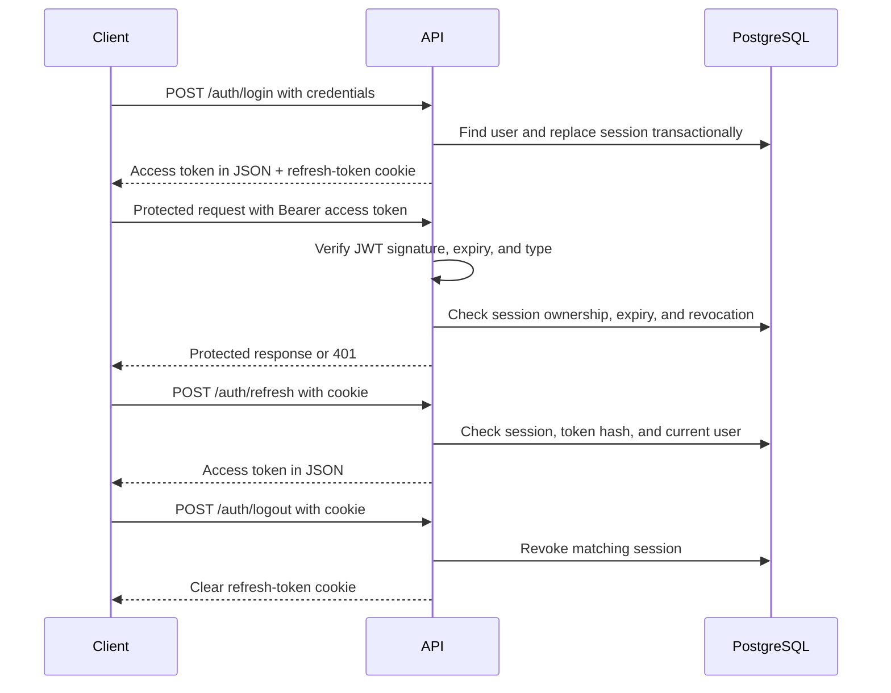

# Notification Service

Express and PostgreSQL backend with JWT authentication, database-backed sessions, and Redis-backed authentication rate limits. Async controllers and authentication middleware forward errors through a shared async handler.

## Getting started

### Docker Compose

Run these commands from the repository root, which contains `compose.yml`. Docker must be running. If you do not already have a root `.env`, copy the example using PowerShell:

```powershell
Copy-Item .env.example .env
docker compose up --build -d
```

Review `.env` before starting. The example credentials and token secrets are for local testing. Compose builds the backend, starts PostgreSQL 16 and Redis 7, waits for both health checks, then runs migrations before starting the API. The default API address is `http://localhost:8000`.

```sh
docker compose ps
docker compose logs -f backend
docker compose down
```

PostgreSQL data persists in the `postgres_data` volume when the stack is stopped with `docker compose down`. Adding `--volumes` deletes that database volume and its data. Redis has no configured persistent volume; do not rely on rate-limit counters surviving container replacement.

Compose reads the root `.env` and explicitly passes the variables listed in its `environment` sections. It does not load `backend/.env`. Inside containers, use `postgres` and `redis` as the database and Redis hostnames. Their ports are not published to the host by this Compose file. The backend `.dockerignore` excludes local `.env` files and `node_modules` from the image.

### Run the backend directly

Start reachable PostgreSQL and Redis services first. From `backend`, copy `.env.example` to `.env` if needed. Set `DATABASE_URL`, `REDIS_HOST`, `REDIS_PORT`, separate `ACCESS_TOKEN_SECRET` and `REFRESH_TOKEN_SECRET` values, and `REFRESH_COOKIE_SECURE=false` for local HTTP. The backend example does not include the token secrets; add them before logging in. For services running on your computer, use `localhost` instead of the Compose service names.

Run commands from the `backend` directory:

```sh
npm install
npm run migrate:up
npm run dev
```

The server checks the PostgreSQL connection before listening. Its default address is `http://localhost:8000`; `GET /health` provides a basic application health response.

The migration runner records completed migrations in `schema_migrations`. Editing a migration that has already been applied does not rerun it or update an existing table. Existing installations must reconcile their schema and migration history before relying on the corrected migration files. `npm run migrate:down` rolls back the most recent migration; the current rollback files drop their respective tables and data.

On PowerShell systems that block `npm.ps1`, use `npm.cmd` in place of `npm`.

## Authentication rate limits

The routes use `express-rate-limit` with `rate-limit-redis` and a shared `ioredis` connection. Each route has its own Redis prefix and fixed-window counter per client IP, with the library's default IPv6 subnet handling. The window begins on the first counted request; subsequent requests do not extend it. All requests count, including successful requests and validation failures.

| Route | Limit | Window | Redis prefix |
| --- | --- | --- | --- |
| Register | 5 | 15 minutes | `notification-service:rate:register:` |
| Login | 10 | 15 minutes | `notification-service:rate:login:` |
| Refresh | 30 | 1 minute | `notification-service:rate:refresh:` |
| Logout | 30 | 1 minute | `notification-service:rate:logout:` |

Change these settings in [`auth.rate-limit.js`](src/modules/auth/auth.rate-limit.js). [`auth.routes.js`](src/modules/auth/auth.routes.js) attaches each limiter before validation and controller execution. Account-based failed-login throttling is not implemented.

Exceeded limits return `429` with `Retry-After` and this response:

```json
{
  "success": false,
  "message": "Too many requests. Please try again later."
}
```

Standard rate-limit headers are enabled; legacy `X-RateLimit-*` headers are disabled. If Redis operations fail, register, login, and refresh forward the error to the central error handler, which currently returns `500`. Logout uses `passOnStoreError: true`, allowing logout to proceed when its Redis store fails; it still enforces its limit when Redis is available.

The Redis client has two-second connection and command timeouts and one retry per request. Use the same Redis service across backend instances to share counters. If deployed behind a reverse proxy, configure Express's trusted proxies to match that deployment so client IP identification is correct.

## Authentication overview

The service uses two JWTs with separate signing secrets:

| Credential | Purpose | Transport | Default lifetime |
| --- | --- | --- | --- |
| Access token | Authenticate requests to protected routes | `Authorization: Bearer <accessToken>` | `1d` |
| Refresh token | Obtain a new access token for an existing session | HttpOnly cookie named `refreshToken` | `7d` |

Both tokens use HS256. Access tokens contain `sub` (user ID), `sid` (session ID), `role`, and `type: "access"`. Refresh tokens contain `sub`, `sid`, and `type: "refresh"`. JWT issuance adds issued-at and expiration claims.

Authentication also checks the database session. A correctly signed, unexpired access token is rejected if its session has expired or been revoked. Each successful login replaces the user's previous session, so the implementation supports one unrevoked session per user.



The diagram abbreviates the route prefix. All authentication endpoints use `/api/v1/auth`.

## API endpoints

| Method | Endpoint | Required input | Successful response |
| --- | --- | --- | --- |
| POST | `/api/v1/auth/register` | JSON: `fullName`, `email`, `password` | `201`, user details |
| POST | `/api/v1/auth/login` | JSON: `email`, `password` | `200`, user and access token; sets refresh cookie |
| POST | `/api/v1/auth/refresh` | Refresh-token cookie | `200`, access token |
| POST | `/api/v1/auth/logout` | Refresh-token cookie when available | `200`, clears cookie and revokes a matching session |

These endpoints do not require an access token. Refresh and logout read the refresh token from the cookie, not from the request body or Authorization header.

### Registration

```http
POST /api/v1/auth/register
Content-Type: application/json

{
  "fullName": "Alex Morgan",
  "email": "alex@example.com",
  "password": "example-password-123"
}
```

Validation requires a trimmed name of 1–100 characters, a valid email of up to 255 characters, and a password with a JavaScript string length of 8–72. The password validation is a string-length check, not a UTF-8 byte-length check.

The service trims and lowercases the email, checks for an existing account, hashes the password with bcrypt using cost factor 12, and inserts the user. The database assigns the default `user` role. Duplicate email addresses return `409`.

The response contains `success: true`, the message `Account created successfully`, and `data.user` with `id`, `full_name`, `email`, `user_role`, and `created_at`. Password hashes are not returned. Registration does not create a session or issue tokens; the client must log in afterward.

### Login

```http
POST /api/v1/auth/login
Content-Type: application/json

{
  "email": "alex@example.com",
  "password": "example-password-123"
}
```

The service normalizes the email, loads the user, and compares the password with the stored bcrypt hash. An unknown email or incorrect password produces the same `401` message: `Invalid email or password`.

After verification, the service generates a UUID session ID and includes that same ID in both tokens and the database session. It hashes the refresh token using SHA-256 and stores the hash rather than the raw token.

Session replacement runs in a transaction:

1. Lock the user's row to serialize concurrent logins for that user.
2. Revoke the user's existing unrevoked sessions.
3. Insert the new session with its token hash and refresh-token expiration.
4. Commit the transaction, or roll it back if an operation fails.

A successful response has this shape:

```json
{
  "success": true,
  "message": "Login successful",
  "data": {
    "user": {
      "id": "1",
      "email": "alex@example.com",
      "user_role": "user",
      "created_at": "2026-01-01T00:00:00.000Z"
    },
    "accessToken": "<access-token>",
    "tokenType": "Bearer"
  }
}
```

The refresh token is sent separately through `Set-Cookie`. The cookie is HttpOnly and expires with the refresh token. The JSON response does not include it.

A later login revokes the earlier session. Tokens from that earlier session fail subsequent session checks even if their JWT expiration has not been reached.

### Protected requests and middleware

[`auth.middleware.js`](src/middleware/auth.middleware.js) exports `authenticate`. For a route that uses it, the middleware:

1. Reads the Authorization header and requires a Bearer token. The scheme is case-insensitive.
2. Calls `authenticateAccessToken()` in the auth service.
3. Verifies the JWT using the access-token secret and HS256, including its expiration.
4. Requires the access-token type, user ID, and session ID.
5. Checks that the database session belongs to that user, is unrevoked, and has not expired.
6. Assigns the returned identity to `req.user` and calls the next handler.

The identity has this shape:

```json
{
  "userId": "1",
  "sessionId": "<session-uuid>",
  "role": "user"
}
```

Errors are passed to the shared error handler. Missing or malformed Bearer credentials return `401`.

The middleware exists but is not currently attached to any application route. The following is an integration example for a future router under `src/modules/<module>`; it does not represent an existing endpoint:

```js
const authenticate = require("../../middleware/auth.middleware");

router.get("/profile", authenticate, (req, res) => {
  res.json({ user: req.user });
});
```

Authentication checks run when requests arrive, not through a background timer. The role in `req.user` comes from the access token; this middleware does not enforce role-based authorization or reload the user's role on every request.

### Expiration and token refresh

When an access token expires, a protected request returns `401` with `Invalid or expired access token`. The middleware does not refresh tokens automatically.

The client can call `POST /api/v1/auth/refresh` with its refresh-token cookie. No request body or valid access token is required. The service:

1. Verifies the refresh JWT's signature, expiration, type, user ID, and session ID.
2. Finds the corresponding unexpired, unrevoked session.
3. Compares the supplied token's SHA-256 hash with the stored hash.
4. Loads the current user and role.
5. Issues an access token for the same session.

```json
{
  "success": true,
  "message": "Token refreshed successfully",
  "data": {
    "accessToken": "<access-token>",
    "tokenType": "Bearer"
  }
}
```

Refresh does not rotate the refresh token, create a new session, reset the cookie, or extend the session expiration. The original refresh token remains usable until expiration or revocation. Even if a newly issued access token has a later JWT expiration, it cannot pass authentication after its database session expires.

### Logout

`POST /api/v1/auth/logout` verifies the supplied refresh cookie and revokes the session matching its user ID, session ID, and token hash. The controller clears the cookie using the same cookie options used at login.

```json
{
  "success": true,
  "message": "Logout successful",
  "data": null
}
```

Missing, invalid, or expired refresh tokens still result in a successful logout response and cookie clearing, but do not perform database revocation. A valid matching token revokes its session, causing later protected requests with that session's access token to fail. The client should also discard its stored access token.

## Frontend integration

The backend provides token endpoints; frontend token storage, refresh orchestration, and request retries are not implemented in this repository.

The expected client flow is:

1. Log in and retain the access token from the JSON response. Allow the browser to store the HttpOnly refresh cookie.
2. Send the access token in the Authorization header on protected requests.
3. If authentication returns `401`, attempt refresh once using the cookie.
4. If refresh succeeds, replace the access token and retry the original request once.
5. If refresh also returns `401`, clear the client authentication state and require login. Do not retry refresh indefinitely.
6. On logout, call the logout endpoint with the cookie and clear the client access token.

An access-token `401` can also indicate revocation or an invalid token, so refresh is not guaranteed to succeed. Network and server errors should be handled separately from authentication failures.

For browser requests made across origins, cookie-based requests require client credentials support, such as `credentials: "include"` with `fetch`. The current application uses default `cors()` configuration and does not enable credentialed cross-origin requests. A separate frontend origin therefore requires corresponding server CORS configuration with an explicit allowed origin and credentials support. Cookie `SameSite` and `Secure` settings must also match the deployment.

## Session storage and indexes

The `user_sessions` table stores one row per session:

| Column | Meaning |
| --- | --- |
| `id` | UUID primary key; matches the JWT `sid` |
| `user_id` | Foreign key to `users.id`; user deletion cascades to sessions |
| `refresh_token_hash` | Unique SHA-256 hash of the refresh token |
| `expires_at` | Session expiration, taken from the refresh token |
| `revoked_at` | Revocation timestamp; `NULL` means unrevoked |
| `created_at` | Creation timestamp |
| `last_used_at` | Reserved timestamp; not updated by the current implementation |

`findActiveSession()` requires all four conditions:

```sql
id = sessionId
AND user_id = userId
AND revoked_at IS NULL
AND expires_at > NOW()
```

The primary-key index supports lookup by session ID. An index on `user_id` supports user-session lookups, while a partial unique index on `user_id WHERE revoked_at IS NULL` enforces one unrevoked session per user. That constraint includes expired but unrevoked rows; expiration is checked separately when authenticating. Login revokes those rows before inserting a replacement.

No join or composite user/session index is required by the current lookup. Expired and revoked rows are retained; no automatic session cleanup job is implemented.

## Configuration

Configuration is loaded from environment variables through `dotenv`. Direct backend execution reads `backend/.env` when started from that directory. Compose uses the repository-root `.env` for interpolation; only variables explicitly mapped in `compose.yml` reach the containers. To customize optional token durations or cookie settings in Docker, also add their mappings to the backend service's `environment` section.

| Variable | Default | Purpose |
| --- | --- | --- |
| `DATABASE_URL` | None | PostgreSQL connection string |
| `PORT` | `8000` | HTTP server port |
| `NODE_ENV` | `development` | Runtime environment |
| `REDIS_HOST` | `localhost` | Redis hostname; `redis` in Compose |
| `REDIS_PORT` | `6379` | Redis connection port |
| `ACCESS_TOKEN_SECRET` | None | Access-token signing and verification secret |
| `REFRESH_TOKEN_SECRET` | None | Refresh-token signing and verification secret |
| `ACCESS_TOKEN_EXPIRES_IN` | `1d` | Access-token lifetime |
| `REFRESH_TOKEN_EXPIRES_IN` | `7d` | Refresh-token and session lifetime |
| `REFRESH_COOKIE_NAME` | `refreshToken` | Refresh-cookie name |
| `REFRESH_COOKIE_SECURE` | `true` | Enables the cookie's Secure flag; only the string `true` enables it |
| `REFRESH_COOKIE_SAME_SITE` | `strict` | Cookie SameSite policy |
| `REFRESH_COOKIE_PATH` | `/api/v1/auth` | Cookie path, shared by login, refresh, and logout |

Compose also requires `POSTGRES_USER`, `POSTGRES_PASSWORD`, and `POSTGRES_DB` in the root `.env`. These initialize PostgreSQL on its first startup with an empty data volume. Keep them consistent with `DATABASE_URL`; URL-encode special characters in its credentials. Changing those initialization variables does not update an existing database user's password. Both `.env` files are excluded from Git; share `.env.example` files instead.

Set separate signing secrets and a valid database connection before using authentication. Duration values should include units, such as `15m`, `1d`, or `7d`.

For local development over plain HTTP, set `REFRESH_COOKIE_SECURE=false`. Use `true` for HTTPS deployment. The default SameSite policy is `strict`; cross-site cookie flows require a deployment-specific configuration. The cookie path must cover the refresh and logout endpoints for the browser to send the cookie to them.

## Error responses

[`async-handler.js`](src/shared/utils/async-handler.js) wraps all four auth controllers and the authentication middleware. It forwards synchronous exceptions and rejected promises to `next(error)`, so repeated controller-level `try/catch` blocks are unnecessary. Service-specific error translation and database transaction rollback still use their own error handling.

Errors use the shared response envelope:

```json
{
  "success": false,
  "message": "Invalid or expired access token"
}
```

Validation responses also include an `errors` object containing field errors.

| Status | Typical cause |
| --- | --- |
| `400` | Registration or login input validation failed |
| `401` | Incorrect credentials, missing/malformed Bearer header, invalid or expired token, missing/revoked/expired session, or refresh-token hash mismatch |
| `409` | Email address already registered |
| `429` | Authentication route rate limit exceeded |
| `500` | Unexpected server, database, or rate-limit store failure; response message is `Internal server error` |

## Code organization

| File | Responsibility |
| --- | --- |
| [`auth.routes.js`](src/modules/auth/auth.routes.js) | Authentication endpoint registration |
| [`auth.rate-limit.js`](src/modules/auth/auth.rate-limit.js) | Auth limiter prefixes, limits, windows, and outage policy |
| [`rate-limit.middleware.js`](src/middleware/rate-limit.middleware.js) | Reusable Redis-backed limiter factory |
| [`redis.js`](src/config/redis.js) | Shared Redis connection |
| [`async-handler.js`](src/shared/utils/async-handler.js) | Central async request-handler wrapper |
| [`auth.validation.js`](src/modules/auth/auth.validation.js) | Registration and login body validation |
| [`auth.controller.js`](src/modules/auth/auth.controller.js) | HTTP responses and refresh-cookie handling |
| [`auth.service.js`](src/modules/auth/auth.service.js) | Password checks, JWT issuance/verification, and authentication rules |
| [`auth.repository.js`](src/modules/auth/auth.repository.js) | User and session queries and login transaction |
| [`auth.middleware.js`](src/middleware/auth.middleware.js) | Bearer extraction and `req.user` assignment |
| [`errorHandler.js`](src/middleware/errorHandler.js) | Shared error-response handling |
| [`migrations`](src/database/migrations) | User and session schema definitions |

## Verification

Run the existing authentication tests from the backend directory:

```sh
node node_modules/jest/bin/jest.js src/modules/auth/auth.test.js src/middleware/auth.middleware.test.js --runInBand
```

The tests cover registration, session-ID persistence during login, cookie-based logout, refresh-token acceptance and rejection, Bearer-header validation, identity forwarding, and middleware error handling. Service tests mock database access; middleware tests mock the auth service. They do not validate live PostgreSQL migrations, Redis rate limits, Docker startup, or browser cookie/CORS behavior. The `npm test` script is currently a placeholder; use the command above.
