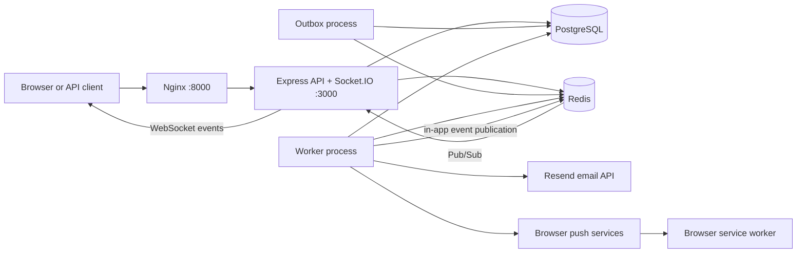
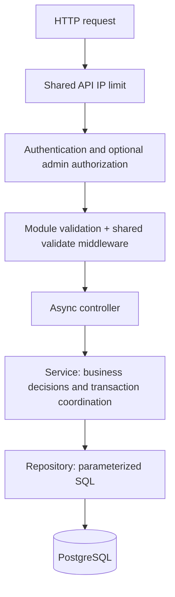
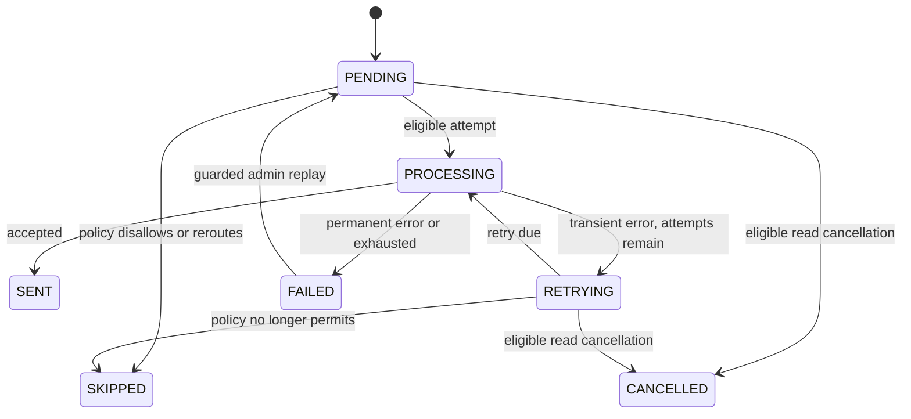

# Software Architecture and Design

Baseline: 30 October 2026; channel queues and database-capacity design updated 1 November 2026. This SDD describes the current development implementation. Product rules live in [requirements](requirements.md); schemas and settings live in the [technical specification](technical-specification.md).

## 1. System context

The service is a modular monolith. Authentication and notifications share one Node.js package and PostgreSQL database. The API, worker, and outbox dispatcher run as separate processes for different workloads. They are not separately owned microservices.



In direct Node development, clients can reach the API on port 3000 without Nginx. The Compose override exposes PostgreSQL and Redis on loopback ports 5632 and 16382. The normal Compose stack publishes Nginx only.

## 2. Runtime responsibilities

| Process/service | Entry point | Responsibility |
| --- | --- | --- |
| API | `backend/src/server.js` | HTTP, Socket.IO, session/ownership checks, request validation, health, metrics |
| Worker | `backend/src/workers/notification-worker.js` | Three channel-specific delivery consumers, one schedule consumer, delivery reconciliation, schedule publication, channel-specific dead-letter publication |
| Outbox | `backend/src/workers/outbox.js` | Poll durable delivery intent and publish BullMQ jobs |
| Migration job | `backend/src/database/migrate.js` | Apply named SQL migrations before API startup |
| PostgreSQL | Compose `postgres` | Users, sessions, inbox, preferences, delivery state, outbox, schedules, device outcomes, failures |
| Redis | Compose `redis` | BullMQ, rate-limit counters, ephemeral presence, real-time Pub/Sub |
| Nginx | `infra/nginx/nginx.conf` | HTTP/WebSocket forwarding, request IDs, controlled forwarded headers |

Each delivery channel has independent concurrency and a Redis-backed job-start rate limit. The schedule consumer uses `WORKER_CONCURRENCY`. With defaults of 3 for all four consumers, the worker can run 12 jobs concurrently. Concurrency is per process; each channel's rate limit is shared across replicas. The serial reconciliation/publication loop also runs alongside consumers.

All four consumers in one process share its PostgreSQL pool. `DB_POOL_MAX` defaults to 20. Startup requires the sum of the four concurrency values plus 2 to fit the pool, reserving one connection for background work and one spare. Provider recipient lookups reuse the delivery's client, so they do not require a second held connection. See [capacity budgeting](technical-specification.md#database-capacity-and-concurrency) before increasing concurrency or process counts.

## 3. Code boundaries



Authentication endpoints are public and use their own endpoint limiters and input validation. Protected routes authenticate before route validation. Controllers consume `req.validated.body`, `.query`, and `.params`; authentication refresh/logout consume their cookie boundary instead of a JSON request schema.

| Folder | Responsibility |
| --- | --- |
| `modules/auth` | Passwords, tokens, sessions, current user/role lookup |
| `modules/notification/notifications` | Owned inbox operations and creation policy |
| `modules/notification/preferences` | Channel permissions and defaults |
| `modules/notification/deliveries` | Internal delivery creation and safe owner-facing reads |
| `modules/notification/subscriptions` | Browser-device subscription lifecycle |
| `modules/notification/presence` | Per-socket presence and conservative fallback |
| `modules/notification/outbox` | Durable delivery intent |
| `modules/notification/schedules` | Scheduled activation, reminders, cancellation |
| `modules/notification/dead-letters` | Admin inspection and guarded replay |
| `modules/operations` | Readiness and database/queue metrics |
| `workers` | Queue execution, reconciliation, routing at delivery time |
| `providers` | Channel-specific provider behavior and per-device persistence |
| `realtime` | Authenticated sockets, event schemas, Pub/Sub bridge |
| `queue` | Queue construction, publication, versioned job contracts |
| `shared` | Small response, error, async, logging, retry-header, and shutdown utilities |

Worker-side ownership/state/preferences checks are necessary because queued work can execute after the original HTTP request. They are not redundant route validation.

## 4. Immediate notification flow

```mermaid
sequenceDiagram
  participant C as Client
  participant A as API service
  participant D as PostgreSQL
  participant O as Outbox process
  participant Q as Selected channel queue
  participant W as Matching delivery consumer
  participant P as Provider
  C->>A: POST notification + optional requestId
  A->>D: BEGIN; serialize same user/requestId if present
  A->>D: Read preferences; insert notification
  A->>D: Insert selected delivery + outbox; add eligible reminders
  A->>D: COMMIT
  A-->>C: 201 notification (delivery is asynchronous)
  O->>D: Claim unpublished intent with row lock
  O->>Q: Publish deterministic job ID
  O->>D: Mark published; COMMIT
  Q->>W: Delivery job
  W->>D: Acquire delivery advisory lock; reload current state
  W->>D: Check permissions/read state; record attempt
  W->>P: Send with timeout and stable delivery identity
  P-->>W: Acceptance or failure
  W->>D: Record result/retry/dead letter
```

Presence is read before creation chooses its initial channel. If all channels are disabled, the transaction still persists the notification and eligible reminder schedules, but no initial delivery is created. Reminder eligibility is re-evaluated later.

The outbox prevents a committed notification from depending on a successful synchronous Redis publication. Publication is still at-least-once: a process can publish to Redis and fail before recording that fact in PostgreSQL. Deterministic job IDs, delivery state, advisory locks, and replay counters limit duplicate work.

## 5. Scheduling and read cancellation

Creation of a future notification inserts a notification plus an `INITIAL` schedule in one transaction. It does not immediately enqueue a delivery. The worker's schedule dispatcher publishes a delayed schedule job. The schedule consumer locks the parent notification before the schedule row, checks due time/current state, and creates delivery plus outbox intent when eligible.

After scheduled activation, reminder schedules are based on the processing time. Later reminders wait for earlier pending schedule/delivery work. When the first reminder is processed, the second due time is kept at least the configured interval gap afterward. Timings therefore represent eligibility targets, not exact delivery guarantees.

Mark-read and read-all persist the read state and cancel pending schedules/eligible delivery work in the same transaction. The shared lock order reduces read-versus-schedule deadlock risk. Already processing work has a narrower cancellation window, and provider-accepted requests cannot be undone.

## 6. Delivery state model



This is the main lifecycle, not every possible recovery edge. Missing/deleted records return cancelled/no-op outcomes; stale replay-round jobs are ignored. A partially successful push can finish `SENT` with a dead-letter record for failed targets and can be eligible for replay of those targets.

## 7. Real-time design

The delivery worker publishes an event envelope to `${REALTIME_PREFIX}:events`. API subscribers validate the envelope, reload owned notification data when needed, check in-app permission for new notifications, and reauthenticate each destination socket before emitting private data.

Sockets use `auth.token` and WebSocket transport. Room names are assigned by the server as `user:<id>`. Each connection has separate Redis sorted-set members for online and active expiry, so disconnecting one tab does not erase another tab's activity. A connection alone is online but inactive; `presence:update` is explicit.

Session validity is rechecked on activity updates, before private events, and periodically. Revocation is not a guaranteed instantaneous broadcast disconnect. Pub/Sub is ephemeral: reconnecting clients must refetch the REST inbox and deduplicate events by notification ID.

## 8. Provider boundaries

| Provider | Design |
| --- | --- |
| In-app | Publish notification ID/user event; API reloads data and emits to authenticated sockets |
| Email | Render escaped HTML/plain text; call Resend with stable delivery idempotency key; classify temporary/permanent responses |
| Push | Encrypt with browser subscription/VAPID details; persist per-device outcomes; remove expired subscriptions; retry unresolved targets |

Providers use current database recipient data, not client-supplied recipient addresses in queue payloads. The worker trusts database channel/stage/recipient state after validating the queue envelope.

## 9. Failure and recovery design

| Failure point | Behavior |
| --- | --- |
| Database transaction fails | Roll back the operation; no partial committed notification/delivery/outbox transaction |
| Valid outbox publication fails | Keep intent unpublished and retry with capped publication backoff |
| Publication result is uncertain | Stable job identity and worker state protect reprocessing; exactly-once is not promised |
| Published active delivery job is missing | Reconciliation can make its outbox intent publishable again |
| Provider returns transient failure | Record retry state and bounded exponential backoff; respect provider delay in persisted next-attempt scheduling |
| Provider fails permanently/exhausts attempts | Record terminal failure and durable dead letter |
| Dead-letter publication fails | Keep database failure record and retry Redis publication |
| Presence lookup fails | Treat user as active to avoid unnecessary extra external sends |
| Post-commit read/delete event publication fails | REST write remains successful; log failure; client recovers by refetch |

## 10. Shutdown and health

Each process installs SIGINT/SIGTERM handling through `shared/utils/shutdown.js`. Stop is idempotent, aborts poll waits, and starts a deadline. The API marks itself draining, stops new HTTP work, closes real-time activity and shared clients. The worker closes consumers before queue/database dependencies. The outbox closes its queue and database. Cleanup groups attempt every close even if one fails. Deadline expiry forces exit 1.

`/health/live` only proves the API responds. `/health/ready` checks Redis and selected migration-history entries through PostgreSQL, and returns unavailable while draining. It does not inspect every table, validate all migration contents, contact email/push providers, or prove worker liveness. Metrics and a functional delivery check provide additional evidence.

## 11. Design decisions and tradeoffs

| Decision | Reason | Tradeoff |
| --- | --- | --- |
| Modular monolith with three processes | Share business/data ownership while isolating request and background workloads | Process availability still needs separate checks |
| PostgreSQL as durable application state | Transactions and constraints keep related intent consistent | Delivery processing holds database connections/locks during provider work |
| Redis/BullMQ for asynchronous execution | Delay, retries, and independent consumers | Redis and PostgreSQL must be reconciled after uncertain outcomes |
| Transactional outbox | Avoid losing intent between database commit and queue publication | Adds polling and duplicate-publication handling |
| Server-side session verification | Current revocation and roles apply to tokens | Protected traffic reads PostgreSQL |
| Per-device push outcomes | Avoid resending to already-successful targets during retries/replay | Additional tables and partial-success semantics |
| REST as durable client recovery source | Pub/Sub events can be missed | Clients need refetch and deduplication behavior |
| Temporary verification files only | Follow repository working instructions | No retained automated regression suite; repeat verification when behavior changes |

Future changes should preserve these guarantees or explicitly update the corresponding requirement and verification record.

### Channel queue rollout

The outbox routes `DELIVERY_REQUESTED` by channel to `notification-delivery-in-app`, `notification-delivery-email`, or `notification-delivery-push`. Recovery checks the matching channel queue; fallback events follow the same routing. Real-time Pub/Sub is unchanged and remains separate from BullMQ queues.

Each channel prefix (`IN_APP`, `EMAIL`, `PUSH`) accepts `_WORKER_CONCURRENCY`, `_WORKER_RATE_MAX`, and `_WORKER_RATE_DURATION_MS`. Default limits are respectively 100, 2, and 10 starts per 1000ms. Excess jobs wait; retries consume capacity. Limits count job starts, not HTTP requests: one push job can contact multiple devices. The [technical specification](technical-specification.md#4-queue-contracts) lists all seven queues and exact settings.

Rollout: stop the old outbox publisher and drain `notification-delivery` with the old worker before switching both processes. Avoid running old and new versions together. Unpublished outbox rows automatically route to the new queues.

Each channel has a dedicated DLQ: `notification-dead-letter-in-app`, `notification-dead-letter-email`, and `notification-dead-letter-push`. The failure dispatcher joins each durable failure to its delivery channel and publishes to that channel's DLQ. Metrics include all three DLQs. The existing admin listing and replay API still use PostgreSQL and replay through the delivery outbox. Existing records in the legacy `notification-dead-letter` Redis queue remain there; retain that queue for historical inspection. No database migration is required.
