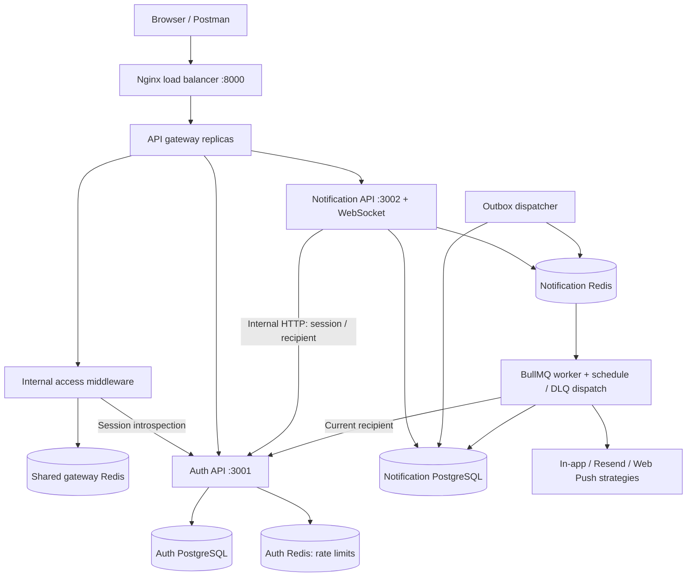

# Microservice architecture

## Ownership and request flow



There are two business services. The worker and dispatcher are separate processes of the notification domain, sharing its owned database. Splitting every notification module into a separate service would break the transaction that creates notification, delivery and outbox intent together.

| Component | Responsibility | Storage |
| --- | --- | --- |
| Auth | Registration, login/refresh/logout, session validation, current user lookup | Users/sessions in Auth PostgreSQL; auth rate limits in Auth Redis |
| Notification | Notification API, delivery policy, preferences, subscriptions, realtime, scheduling and recovery | Its own PostgreSQL and Redis |
| API gateway | Public route allowlist, pre-forward IP limits, token/role validation and WebSocket proxy | Shared gateway Redis through internal middleware |
| Nginx edge | Public entry, gateway balancing, trusted forwarding headers/request IDs | None |

The gateway is Nginx. Its access hook calls internal Express middleware for centralized global/route IP limits and Auth session introspection before forwarding. Notification verifies the signed gateway identity and enforces ownership and business authorization. The gateway cannot turn a client-supplied user ID into an authenticated identity. See [gateway rate limiting](../gateway/api-gateway/README.md) for settings, IP trust and failure behavior.

For a notification POST, both Nginx layers forward the request to Notification. The gateway first validates the session with Auth. Notification verifies the signed gateway identity and synchronizes `notification_recipients` without a second HTTP introspection. Route validation then supplies `req.validated.body`; controller → service → repository creates notification, delivery and outbox in one transaction. The dispatcher publishes durable intent into BullMQ. A worker reloads policy, asks Auth for the current recipient and calls the selected strategy. Existing retry, scheduling and DLQ rules remain in effect.

`notification_recipients` stores only Auth's user ID, email and update timestamp. IDs are not generated there. It supplies local foreign keys without a shared users table. Auth is the source of truth; email is fetched again before sending. User deletion is detected at delivery/session validation, but automatic removal of the retained notification projection/history is not implemented.

## Internal contract

Both internal endpoints require `X-Service-Token` equal to `INTERNAL_SERVICE_TOKEN`. The key must be at least 32 characters. The public proxies strip this header and do not route `/internal`.

| Internal endpoint | Input | Successful response |
| --- | --- | --- |
| `POST /internal/v1/auth/introspect` | `{ "token": "access JWT" }` | `{ "user": { "userId": "1", "role": "user", "email": "user@example.com", "sessionId": "UUID" } }` |
| `GET /internal/v1/users/1` | Recipient ID in path | Same user fields, without sessionId |

The internal client checks response shape and enforces `AUTH_SERVICE_TIMEOUT_MS` (default 3000). There is no cached authentication fallback. Auth outage makes protected notification requests return 503 and notification readiness fail; delivery attempts retry within their normal budget. A prolonged outage may exhaust retries and create a DLQ entry for later controlled replay. Auth and Notification APIs can scale independently, but availability of authenticated notification work still depends on Auth.

## Networking and balancing

Only the edge publishes a host port. Internal APIs share the `services` network; each datastore uses its own private network. Notification processes additionally have outbound networking for providers. Docker networks are isolation boundaries for this local stack, not a replacement for production TLS/service identity.

Nginx 1.28 uses Docker DNS with a 5-second refresh and shared upstream zones. Edge uses least connections over gateway replicas; gateways distribute calls over API replicas. Each Express app trusts two proxy hops; edge replaces incoming forwarded IP/request ID and strips the internal service token. Do not expose Node ports or the gateway publicly with this trust configuration unchanged.

WebSocket upgrades are forwarded at both layers. Socket.IO uses `transports: ["websocket"]`; clients must select WebSocket transport. Browser login/refresh supplies a scoped HttpOnly socket cookie for gateway validation; the Socket.IO auth token must match it. Native clients can send a Bearer header. See the gateway guide for the current handshake contract. Redis pub/sub reaches API replicas, so sticky sessions are not needed. Existing sockets reconnect when their replica disappears.

GET failover was verified after Docker DNS converged. An immediate request during replica removal returned 504 in testing; this is **not zero-downtime failover**. Nginx retries eligible upstream errors, but sent non-idempotent requests are not automatically replayed. Keep using notification `requestId` for safe client retry. Proxy-generated errors may be Nginx HTML; application responses retain their existing JSON shape. The single edge, databases and Redis instances remain single points of failure in this local topology.

Nginx references: [dynamic upstream resolution](https://nginx.org/en/docs/http/ngx_http_upstream_module.html), [WebSocket proxying](https://nginx.org/en/docs/http/websocket.html).

## Direct Node development

Install Node 24 and each service's dependencies. Create each service's `.env` from its example if absent, **before running migrations**. Match database credentials to root `.env`, and set the same internal token in both service files. Start only the four datastores with the optional localhost bindings:

```powershell
docker compose -f compose.yml -f infra/compose.local.yml up -d auth-db notification-db auth-redis notification-redis
npm --prefix services/auth-service ci
npm --prefix services/notification-service ci
npm --prefix services/auth-service run migrate:up
npm --prefix services/notification-service run migrate:up
```

Auth connects to localhost:5631/16381; Notification to localhost:5632/16382 and Auth at `http://localhost:3001`.

Run `npm run dev:auth`, `npm run dev:notifications`, `npm run worker` and `npm run outbox` in separate terminals at the root. Postman uses Auth at :3001 and Notification at :3002 in this mode; the two Nginx layers are only used by the full Compose stack. The local override attaches datastores to an additional development network so Docker can bind their localhost ports.

Normal Compose uses root `.env`, not service `.env` files. Secret values are explicitly assigned per service. `CORS_ORIGINS` configures allowed browser HTTP origins with credential support; `SOCKET_ORIGINS` configures WebSocket origins. Node configuration supports relevant `*_FILE` secret settings, but Compose does not automatically mount secret files. Never copy notification DB credentials into Auth, or JWT signing secrets into Notification.

## Existing data

The old `backend` directory moved to `services/notification-service`; authentication moved into its own service. The original local backend environment was backed up to ignored `infra/legacy/.env`. No real legacy database was changed or imported during implementation.

New service migrations are for **fresh databases**. Do not run them against the legacy database: migration 001 now has a different notification-service meaning. Keep the legacy volumes and a database backup.

`tools/migrate-legacy.cjs` copies an existing Phase 8/9 schema into two empty, already-migrated databases. It requires installed notification-service dependencies. It keeps user IDs, password hashes, sessions, delivery attempts, subscriptions, push outcomes, schedules and replay history. It does not copy the old migration ledger.

1. Stop all legacy writers, APIs, workers and dispatchers. Back up the source and keep it stopped throughout the copy.
2. Start fresh service datastores and run only `auth-migrate` and `notification-migrate`. Keep target APIs/workers/dispatchers stopped. If importing from the host, use the local datastore override and install notification dependencies first.
3. Set `LEGACY_DATABASE_URL`, `AUTH_DATABASE_URL`, and `NOTIFICATION_DATABASE_URL` to three distinct reachable databases in your shell. Use a read-only legacy credential where possible. Run `npm run migrate:legacy`.
4. Check the printed table counts. Preserve the original JWT secrets in Auth if existing sessions should continue working. Start the new APIs/workers only after the copy succeeds.

The source transaction is read-only. Targets must be empty and the tool refuses to merge with existing rows. It uses two target transactions, **not a distributed atomic commit**: if the second commit fails after Auth commits, restore/recreate both empty targets and rerun. Keep target writers stopped; the advisory lock coordinates migration/import tools, not ordinary requests.

Redis is not copied. Notification reconciliation can republish pending deliveries; schedules are recovered from durable database records. The importer resets DLQ publication markers so the dispatcher rebuilds the DLQ without resending those failed deliveries. Completed BullMQ job history, rate-limit counters and live presence are not preserved. Browser sockets reconnect. Provider idempotency windows still limit exactly-once guarantees; historical external effects cannot be rolled back.

## Verification record — October 21, 2026

An isolated disposable Compose project built both service images and both Nginx images, applied fresh migrations, and ran with two gateways, two Auth APIs and two Notification APIs.

- 17 end-to-end checks passed: readiness, internal-route isolation, register/login/refresh, header spoof rejection, admin restriction, private multi-tab WebSocket delivery, concurrent request idempotency, ownership, actual outbox/worker in-app delivery, read state, scheduling, preferences, invalid socket auth, logout HTTP/socket revocation and generated request IDs.
- Logs confirmed traffic reached both replicas of each gateway/API. Replica-removal failover passed after DNS convergence; the initial transient 504 is documented above.
- Stopping both Auth replicas kept liveness up but made readiness/protected notification requests fail closed. Services recovered after restoration.
- Live role changes applied to an existing access token. Auth had no notification tables; Notification had no users/sessions tables or JWT signing secrets.
- Offline import rehearsal preserved IDs, hashes, sessions, JSON null, attempts, schedules and DLQ actor references; reset DLQ publication; advanced the identity sequence; rejected occupied targets; left source data unchanged.
- Provider boundary checks used real internal Auth HTTP and a mocked email API: current email replaced stale projected email, temporary/permanent failures retained their classification, missing recipients failed permanently, Auth outages remained retryable, and IN_APP/PUSH strategy dispatch remained intact. All 115 JavaScript files passed syntax checks.

Temporary test files, containers and volumes are removed after verification. Real email delivery and browser/device push were not exercised during this conversion. CI/CD, deployment, TLS provisioning and production high availability were not part of this change.
