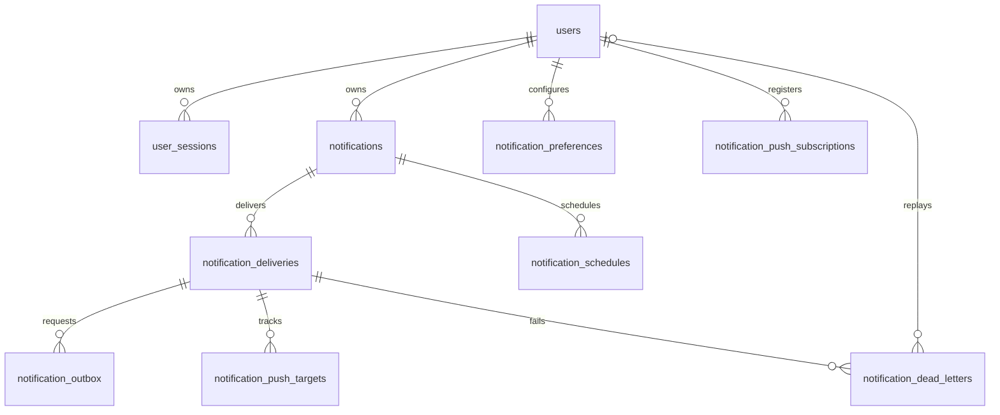

# Technical Specification

Baseline: 30 October 2026. This TSD describes implementation details. See [architecture](architecture.md) for flows, [client contracts](client-contracts.md) for HTTP/WebSocket integration, and [development](development-guide.md) for commands.

## 1. Technology baseline

| Component | Repository baseline |
| --- | --- |
| Runtime | Node.js 24 container; local verification used Node.js 24 |
| Language/style | JavaScript CommonJS; two spaces; double quotes; semicolons |
| HTTP | Express 5, Helmet, CORS, cookie-parser |
| Validation | Zod 4 and `middleware/validate.js` |
| Persistence | PostgreSQL 16; `pg` pool |
| Background work | Redis 7, BullMQ 6, ioredis |
| Real-time | Socket.IO 4; WebSocket transport |
| Authentication | bcrypt 6; jsonwebtoken 9; HS256 |
| External delivery | Resend HTTP API and `web-push` request generation |
| Development | nodemon; socket.io-client for verification |

Exact dependency resolution is recorded in [backend/package-lock.json](../backend/package-lock.json), not in this version summary. The root package delegates scripts to the backend package.

## 2. Database model

PostgreSQL is the durable source for application and delivery state. Redis does not replace the inbox, outbox, schedule, or failure tables. Timestamps use `TIMESTAMPTZ`; clients should exchange ISO timestamps with a timezone.



`notification_push_targets.subscription_id` intentionally has no foreign key to subscriptions. Device outcome history survives subscription removal. It is a logical association only and is read using a left join.

### Table dictionary

| Table / migration | Key | Important fields and constraints |
| --- | --- | --- |
| `users` / 001 | Identity BIGINT `id` | `full_name` varchar(100), unique `email` varchar(255), `password_hash`, `user_role` default `user`, created/updated timestamps |
| `user_sessions` / 002 | UUID `id` | User FK; unique SHA-256 `refresh_token_hash` char(64); expiry/revocation timestamps; partial unique index on unrevoked user session |
| `notifications` / 003 | UUID `id` | User FK; checked type; title varchar(200); message text; JSONB data default `{}`; read/scheduled timestamps; optional UUID request ID; unique `(user_id, request_id)` |
| `notification_deliveries` / 004 | UUID `id` | Notification FK; checked channel/stage/status; attempt/replay counts; push initialization; provider ID/error/retry/sent timestamps; unique `(notification_id, channel, stage)` |
| `notification_preferences` / 005 | `(user_id, channel)` | User FK; checked channel; enabled flag; timestamps |
| `notification_outbox` / 006 | UUID `id` | Delivery FK; event type `DELIVERY_REQUESTED`; object JSONB payload; publication attempt count; next-attempt/published/error fields |
| `notification_push_subscriptions` / 007 | UUID `id` | User FK; globally unique endpoint, at most 2048 characters; p256dh/auth keys; created timestamp |
| `notification_push_targets` / 008 | `(delivery_id, subscription_id)` | Delivery FK; status `PENDING/RETRYING/SENT/FAILED/CANCELLED`; attempt count; error code; updated timestamp |
| `notification_dead_letters` / 009 | UUID `id` | Delivery FK; unique `(delivery_id, replay_count)`; reason/attempts/failure time; publication state; replay time/admin reference |
| `notification_schedules` / 010 | UUID `id` | Notification FK; unique `(notification_id, stage)`; due/check timestamps; `PENDING/COMPLETED/CANCELLED`; publication attempts/error/completion fields |
| `schema_migrations` / runner | Migration name | Applied timestamp; runner bookkeeping rather than a domain migration |

All user-owned tables with a user FK cascade when the user is deleted. Notification deletion cascades through schedules/deliveries and delivery-dependent tables. `replayed_by` becomes null when the referenced admin is deleted. There is no public account-deletion API.

### Index and constraint intent

- Inbox indexes order by `(user_id, created_at DESC, id DESC)`; an unread partial index supports unread listings.
- Session uniqueness counts unrevoked sessions, even if expired. Login revokes old sessions before inserting its replacement; active-session queries also check expiry.
- Delivery uniqueness prevents duplicate channel/stage records; replay resets the existing delivery and increments its replay round.
- Unpublished outbox/dead-letter indexes and pending schedule indexes support polling.
- Subscription-count limit 20 is enforced in the service under a user-row lock; it is not a database count constraint.
- Database type/status checks protect internal writers as well as HTTP paths. User roles are not restricted by a database enum/check; authorization compares the current value to `admin`.
- No automatic inbox, session, outbox, or dead-letter retention cleanup is implemented. Queue retention is separate from database retention.

Full DDL is in [database/migrations](../backend/src/database/migrations). Editing consolidated migrations does not alter a database that already recorded their names. See the migration-history limitation in the [development guide](development-guide.md).

## 3. Transaction and locking contracts

| Operation | Transaction / lock |
| --- | --- |
| Login | Lock user row; revoke old sessions and insert new session in one transaction |
| Idempotent create | Transaction-scoped advisory lock for user/request ID; compare content before insert |
| Notification create | Same client for notification, delivery, outbox, and schedule inserts |
| Mark-read/read-all | Persist read state and cancel eligible work using one client/transaction |
| Subscription registration | User-row lock serializes per-user limit checks and inserts; endpoint uniqueness handles cross-user conflict |
| Outbox/schedule/dead-letter publication | Claim one eligible row with `FOR UPDATE SKIP LOCKED`; update publication state transactionally |
| Delivery execution | Session advisory lock keyed by delivery ID; retain until processing finishes and unlock before releasing client |
| Replay | Transaction advisory lock on same delivery key; validate/reset/enqueue/mark replayed in one transaction |
| Migration | Session advisory lock `742019008`; each file and its recorded name commit together |

Provider work can run while a worker holds a database client and a delivery advisory lock. This coordinates delivery attempts but consumes pool capacity during external latency. There is no distributed transaction between PostgreSQL, Redis, and providers.

## 4. Queue contracts

| Queue | Job name | Identity | Retention |
| --- | --- | --- | --- |
| `notification-delivery` | `deliver-notification` | Delivery UUID; replay uses `<deliveryId>-replay-<count>` | Completed age 86400 seconds/count 1000; failed retained |
| `notification-schedule` | `activate-notification-schedule` | Schedule UUID | Same completed/failed policy |
| `notification-dead-letter` | `failed-delivery` | Dead-letter UUID | Completed and failed jobs retained |

The dead-letter queue has a producer but no consumer in this repository. Admin inspection and replay use PostgreSQL records, not removal/requeue of a dead-letter BullMQ job.

### Delivery payload

```json
{
  "version": 1,
  "notificationId": "7a6fd9ad-b381-4f57-92e9-bbc9cb9c1b76",
  "deliveryId": "28724bce-cdad-4fc9-9d09-3c4716dc60f9",
  "channel": "IN_APP",
  "stage": "INITIAL",
  "idempotencyKey": "28724bce-cdad-4fc9-9d09-3c4716dc60f9",
  "replayCount": 0
}
```

UUID fields, version, channel, stage, replay bounds, strict keys, and `idempotencyKey === deliveryId` are validated. Replay count defaults to zero. Recipient, message, and actual processing policy come from PostgreSQL. A stale replay count is ignored. Invalid jobs fail unrecoverably.

The schedule payload is `{ "version": 1, "scheduleId": "<UUID>" }`. A dead-letter payload contains `deadLetterId`, `deliveryId`, originating `jobId`, `replayCount`, `reason`, `attemptCount`, and ISO `failedAt`.

### Retry and publication details

- Delivery attempt default: 5. Both job options and configured limits bound execution.
- Exponential base delay: `DELIVERY_BACKOFF_MS * 2^(attempt_count - 1)` after a send failure.
- Persisted delay is the maximum of that backoff and parsed provider `Retry-After`. A worker delays the job again if `next_attempt_at` is still in the future.
- HTTP 408, 429, 5xx, network errors, and selected provider conflicts are retryable; permanent provider errors fail without exhausting every attempt.
- Outbox publication backoff is exponential and capped at 60 seconds. Publication failure does not consume a delivery send attempt.
- Invalid outbox payloads remain unpublished with `next_attempt_at = infinity` and a manual-repair error; they are not retried forever.
- Queue publication timeout is 5 seconds. Timeout is an uncertain outcome, not proof that Redis rejected publication.
- Worker loop reconciles up to 100 published active deliveries per page and publishes up to 25 schedules and 25 dead letters per cycle. Outbox handles up to 25 records per cycle.
- Schedule dispatcher rechecks pending intent at `SCHEDULE_RECHECK_MS`, recreating missing or terminal queue jobs while the schedule remains pending.
- Delivery and schedule workers use `maxStalledCount=2`.

## 5. Provider specification

### Email

`notification-email.provider.js` calls `POST https://api.resend.com/emails`. It uses `EMAIL_FROM`, current recipient email, escaped HTML/plain text, and `Idempotency-Key: notification/<deliveryId>`. Subject CR/LF characters are replaced with spaces. Redirects are rejected.

Missing key/sender is unrecoverable. Successful response must contain a nonempty string `id`. Responses 408, 429, 5xx and 409 with `name=concurrent_idempotent_requests` are temporary; other non-success responses are permanent. Successful HTTP acceptance does not establish final delivery or inbox placement. Provider idempotency support does not imply an unlimited application exactly-once guarantee.

### Web Push

Supported endpoints are HTTPS hosts `fcm.googleapis.com`, `updates.push.services.mozilla.com` and its subdomains, or `web.push.apple.com`. Credentials, nondefault ports, and fragments are rejected. Public key validation checks a P-256 public point and base64url shape; auth key format is also checked.

Registration rejects expired input `expirationTime`; the value is not persisted as a subscription expiry column. Re-registering an identical endpoint/key pair for the same user returns the existing identifier. Endpoint owner/key changes require explicit unsubscribe; conflicts return 409.

The payload contains `notificationId`, title truncated to 100 Unicode code points, and body truncated to 300. TTL is 3600 seconds. Topic is the delivery UUID without hyphens. Per-device send outcomes are persisted; already-successful targets are not resent on ordinary retries.

| Response/outcome | Handling |
| --- | --- |
| 2xx | Target `SENT` |
| 404 / 410 | Remove expired subscription; target `CANCELLED` |
| 408 / 429 / 5xx | Target `RETRYING`; use Retry-After where supplied |
| Network failure | Target `RETRYING` |
| Other rejection | Target `FAILED` |
| Subscription already removed | Target `CANCELLED` |
| No accepted target | Push unavailable; initial delivery can fall back to enabled email |
| Some sent and some permanently failed | Delivery can be `SENT` with partial-failure dead letter |

The send deadline aborts fetch activity. Push waits for abort cleanup before releasing its database client/lock because device outcomes use that client. It is a best-effort provider-operation deadline, not a guaranteed hard bound on all database cleanup.

## 6. Configuration reference

Values below are source defaults unless marked otherwise. Root `.env` configures Compose interpolation. Direct Node commands load `.env` from their working directory, so run them in `backend` or use the root delegating npm scripts.

### Core and authentication

| Setting | Default / requirement |
| --- | --- |
| `NODE_ENV` | Source: `development`; Compose fallback/container image: `production`; examples explicitly choose development |
| `PORT` | API source: 3000, integer 1..65535; root Compose: public Nginx port default 8000, backend fixed at 3000 |
| `DATABASE_URL` | Supply a valid PostgreSQL connection string; Compose constructs it from root database variables |
| `POSTGRES_USER`, `POSTGRES_PASSWORD`, `POSTGRES_DB` | Root Compose database settings; match direct Node URL to the same database |
| `ACCESS_TOKEN_SECRET`, `REFRESH_TOKEN_SECRET` | Required by startup validation; at least 32 characters each; configure separate values |
| `ACCESS_TOKEN_EXPIRES_IN` | `1d` |
| `REFRESH_TOKEN_EXPIRES_IN` | `7d` |
| `REFRESH_COOKIE_NAME` | `refreshToken` |
| `REFRESH_COOKIE_SECURE` | Source default `true`; Compose default/examples `false` for local HTTP |
| `REFRESH_COOKIE_SAME_SITE` | `strict` |
| `REFRESH_COOKIE_PATH` | `/api/v1/auth` |
| `CORS_ORIGINS` | Comma-separated `http://localhost:3000,http://localhost:5173` |
| `RATE_LIMIT_MAX` | 100; allowed 1..1000000 |
| `RATE_LIMIT_WINDOW_MS` | 60000; allowed 1..86400000 |
| `SHUTDOWN_TIMEOUT_MS` | 75000; allowed 1..300000; Compose stop grace is 90 seconds |

Secrets `DATABASE_URL`, `ACCESS_TOKEN_SECRET`, `REFRESH_TOKEN_SECRET`, `RESEND_API_KEY`, and `VAPID_PRIVATE_KEY` also support a corresponding `_FILE` environment variable. When present, that file's trimmed contents take precedence. The checked-in Compose configuration passes direct values, not file mounts.

### Redis, queues, and real-time

| Setting | Default / range |
| --- | --- |
| `REDIS_HOST`, `REDIS_PORT` | Source `localhost:6379`; Compose `redis:6379`; direct example `localhost:16382` |
| `REDIS_MAXMEMORY` | Compose 256mb; `noeviction`, append-only persistence |
| `DELIVERY_MAX_ATTEMPTS` | 5; 1..20 |
| `DELIVERY_BACKOFF_MS` | 1000; 1..60000 |
| `WORKER_CONCURRENCY` | 3 per consumer; 1..5 |
| `DELIVERY_TIMEOUT_MS` | 10000; 1..60000 |
| `OUTBOX_POLL_MS` | 1000; 1..60000 |
| `SOCKET_ORIGINS` | Same localhost origins as CORS; independently configured |
| `SOCKET_CHECK_MS` | 15000; 1..60000; actual interval is min(value, floor(presence TTL / 3)) |
| `PRESENCE_TTL_MS` | 60000; 1..300000 |
| `REALTIME_PREFIX` | `notification-service:realtime` |

Presence heartbeat guidance is `floor(PRESENCE_TTL_MS / 3)`. Redis prefix changes isolate presence/PubSub only; they do not rename BullMQ queues or rate-limit keys. Separate development environments should use separate Redis instances when full isolation is needed.

Database pool per process: maximum 50 clients, idle timeout 30 seconds, connection timeout 5 seconds. API/auth Redis connection: 2-second connect/command timeout and one per-request retry. Queue producers disable the offline queue, use 2-second connect/5-second command timeouts and one per-request retry. Worker connections allow indefinite command retries as required by BullMQ. Real-time connections are lazy with 2-second connect/command timeouts.

### Providers and schedules

| Setting | Default / requirement |
| --- | --- |
| `RESEND_API_KEY`, `EMAIL_FROM` | Empty; both required for actual email send |
| `VAPID_PUBLIC_KEY`, `VAPID_PRIVATE_KEY`, `VAPID_SUBJECT` | Empty; all required for configured push |
| `REMINDERS_ENABLED` | `true`; explicit initial schedules still work when false |
| `REMINDER_FIRST_MS` | 1800000; 1..2592000000 |
| `REMINDER_SECOND_MS` | 86400000; same range; must exceed first when max count is 2 |
| `REMINDER_MAX_COUNT` | 2; allowed 1 or 2 |
| `REMINDER_TYPES` | `SYSTEM,SECURITY`; each value must be a supported notification type |
| `SCHEDULE_RECHECK_MS` | 60000; 1..300000 |

Boolean settings compare literal strings with `true`; use explicit `true`/`false`. Positive integer settings fail startup outside their bounds. Not every setting is fully validated at startup: malformed cookie/token duration/provider/database values can fail when used. Configuration presence is not proof of provider readiness.

## 7. Security and boundary behavior

- bcrypt accepts passwords of 8..72 characters and at most 72 UTF-8 bytes at the HTTP boundary.
- Tokens are HS256, typed access/refresh, with validated numeric user ID and UUID session ID. Current role/session state comes from PostgreSQL.
- Refresh token storage is SHA-256 hash only. Cookie is HttpOnly with configured SameSite/Secure/path.
- Parameterized SQL carries external values. Dynamic SQL fragments are internal filter clauses, not raw client SQL.
- API-wide IP limit is 100/minute by default. Register: 5/15 minutes; login: 10/15 minutes; refresh/logout: 30/minute.
- Redis limiter errors normally return 503. Logout's own limiter permits store errors, but the preceding global API limiter still applies.
- CORS and socket-origin checks are independent. CORS is not authentication and does not govern non-browser clients.
- Express trusts one proxy hop; Nginx replaces forwarded IP/protocol headers. Avoid shared untrusted direct access that bypasses this topology.
- Nginx limits request body size to `100k`; Express's JSON parser also uses its default size limit. Not every parse/size error is normalized to a specific public 4xx by the current error handler.
- Generic unexpected server errors return `Internal server error`; logs use structured events and request IDs. Public delivery reads omit provider error details.
- Push endpoint restriction prevents arbitrary host submission. Do not add unrestricted URLs as a convenience.

## 8. Health, metrics, and known implementation limits

`/health` returns the standard success envelope; `/health/live` returns `{ "status": "alive" }`; `/health/ready` returns `{ "status": "ready" }` or `{ "status": "unavailable" }` with 200 or 503. Readiness requires Redis PONG and four migration names: 001 users, 002 sessions, 003 notifications, and 010 schedules. It is not a full schema integrity check.

Admin metrics return `collectedAt`, `database`, and `queues`. Database fields include `outbox_pending`, `outbox_oldest_seconds`, `deliveries_failed`, `deliveries_retrying`, `retained_retry_attempts`, `delivery_oldest_seconds`, `dlq_unreplayed`, `dlq_unpublished`, `schedules_overdue`, `reminder_schedules`, and `reminder_deliveries`. Each queue reports wait/active/delayed/failed/completed counts and `oldestWaitingSeconds`.

These are snapshots over retained records, not lifetime totals or proof of worker health. Pub/Sub has no replay history. Queue jobs may outlive deleted database records. No automated database cleanup, periodic backup, performance benchmark, rate-limit exhaustion test record, full concurrency proof, or complete fault-injection suite is included in this baseline.
